## Overview

RAVE can now be operated by AI agents. An AI agent is a chat app that can also use other programs for you. Install the free **RAVE Agents** plugin (a small add-on for your AI app), then describe what you want in plain English. The agent works in the RAVE window you are watching, and takes care of jobs that used to take many clicks and a lot of time.

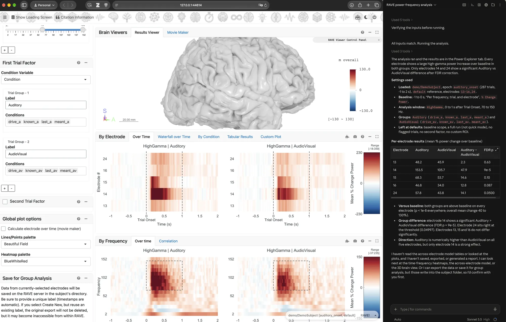{width="100%"}

### What can AI agents do for you?

1. **Run a whole analysis from one request.** Ask once, and the agent starts RAVE, opens the right module, runs the analysis, sums up the results and writes a report for you.

2. **Use AI for quick answers about RAVE.** Not sure how to do something, like switching the 3D viewer to the coronal layout or changing the colors? Just ask. You can choose to do it yourself, or let the agent do it for you.

3. **Carry an analysis across modules.** Found electrodes with significant broadband high-frequency responses in Power Explorer? Ask:

   > Load these electrodes in Voltage Explorer, apply the same analysis settings, and show me their ERP responses.

   or

   > Load these electrodes in Power Clustering, apply the same analysis settings, and show me the response patterns.

   No need to enter the same settings again in every module.

4. **Apply the same analysis, different subjects, automatically.** AI agents know how RAVE works. Describe the analysis you want, and the agent sets it up as a reproducible RAVE pipeline (a saved analysis you can run again). Or ask it to save your analysis as a reusable recipe (called a "skill"), then run it on all your subjects with the same settings.

### Which AI agent?

RAVE Agents works with most AI agents, including Claude Code, OpenAI Codex, Google Gemini, GitHub Copilot and Cursor. This guide uses Claude Code in the Claude Desktop app as the example. Using a different AI app? See [these setup instructions](https://github.com/rave-ieeg/agents/blob/main/INSTALLATION.md){target="_blank"}.

## What you need

- **RAVE**, installed by following the [Installation Guide](../installation/installation.md).
- **Node.js**, a free helper program that RAVE Agents needs. You install it with RAVE's [Installation Guide](../installation/installation.md) (Step 1, then choose your operating system):
  - On a Mac, it is part of the step "Install libraries using brew". If RAVE is already installed, run that step again.
  - On Windows or Ubuntu, follow the step "(Optional) Install Node.js for AI features".
- **An AI agent app.** Most need a paid subscription. This guide uses the Claude Desktop app (for Mac or Windows) with Claude Code.

## Step 1: Install RAVE Agents (one time)

These steps use the Claude Desktop app. Codex works in a very similar way: you add `rave-ieeg/agents`, then install RAVE Agents.

1. Open the Claude Desktop app and click the **Code** tab (the `</>` icon at the top left).

   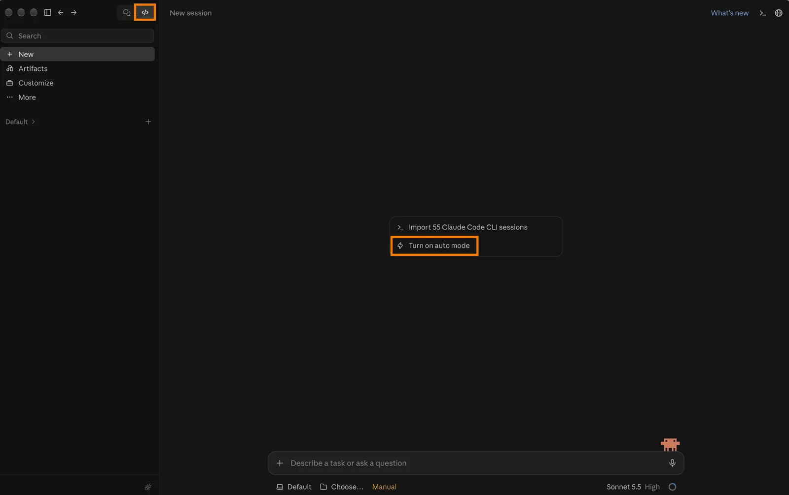{width="75%" fig-alt="The Claude Desktop app with the Code tab and the 'Turn on auto mode' button highlighted"}

2. In the message box, type `/plugin` and choose **plugin** ("Manage Claude Code plugins"). Words that start with `/` are shortcuts in the message box. You can also click **Customize** in the left sidebar, then **Plugins**.

   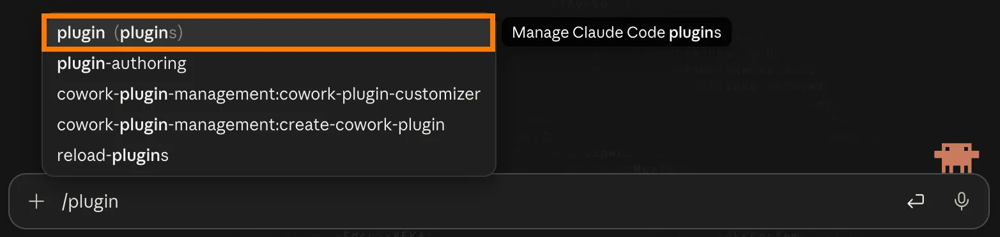{width="70%" fig-alt="Typing /plugin in the message box shows 'Manage Claude Code plugins'"}

3. Click **+ Add**, then **Add marketplace**. A marketplace is a list of plugins you can install. Type `rave-ieeg/agents` and choose **Use "rave-ieeg/agents"**.

   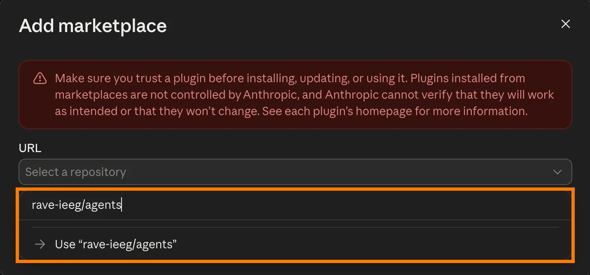{width="60%" fig-alt="The Add marketplace window with rave-ieeg/agents typed in"}

   Don't worry about the red warning: the app shows it for every plugin it didn't make itself. `rave-ieeg/agents` is the RAVE team's official plugin, published on [GitHub](https://github.com/rave-ieeg/agents){target="_blank"}.

4. Find **RAVE Agents** in the list of plugins and click **Install**.

   <!-- TODO: add screenshot intro-setup-5-install.webp: RAVE Agents with its Install button, as a first-time user sees it right after adding the marketplace. Also confirm where RAVE Agents shows up in the plugin list. -->

5. Make sure the switch next to RAVE Agents is on (blue).

   {width="80%" fig-alt="RAVE Agents installed, with its switch turned on"}

6. Click **+ New** in the left sidebar to start a new conversation, so that Claude picks up RAVE Agents.

## Step 2: Ask

Tell the agent what you want, in your own words. Mention RAVE, so the agent knows to use RAVE Agents. In Claude, you can also start your message with `/rave` to make sure. For example:

> /rave Start RAVE, I want to analyze the power-frequency data collected from demo/DemoSubject

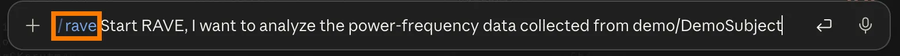{width="70%" fig-alt="The /rave request typed into the message box"}

`demo/DemoSubject` is the demo subject that comes with RAVE. If RAVE is not running yet, the agent asks before starting it. Click **Start RAVE**, and RAVE opens in your web browser.

<!-- TODO: add screenshot intro-chat-2-start-rave.webp: the agent asking whether to start RAVE, with the "Start RAVE" button -->

::: callout-tip
By default, Claude asks for your OK before each step, and one analysis can take more than 20 steps. To let it work without stopping, click **Turn on auto mode** (see the first picture in Step 1). Even then, RAVE Agents asks you before it loads data or saves anything.
:::

## Example: a power analysis in plain English

Here is what happened after the request above.

### 1. The agent asks for your choices before loading

The agent opened Power Explorer and listed every choice it needs: electrodes, epoch, reference, time windows, frequency range, and so on. Loading reads a lot of data, so the agent does not guess. Answer in your own words, or click **Use defaults**.

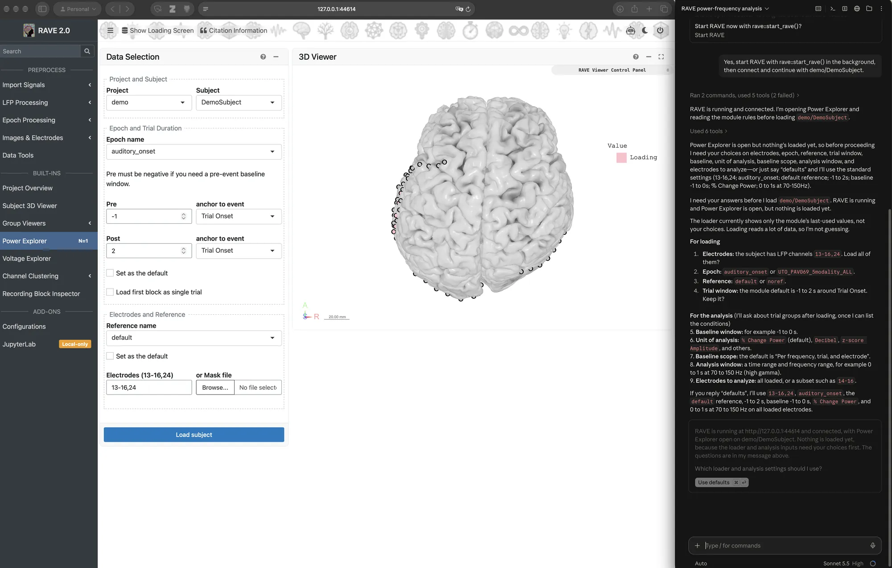{width="100%" fig-alt="RAVE Power Explorer on the left; the agent's questions about loading and analysis settings on the right"}

### 2. RAVE loads the data

The agent fills in the settings and loads the subject. Its checklist shows how far along it is.

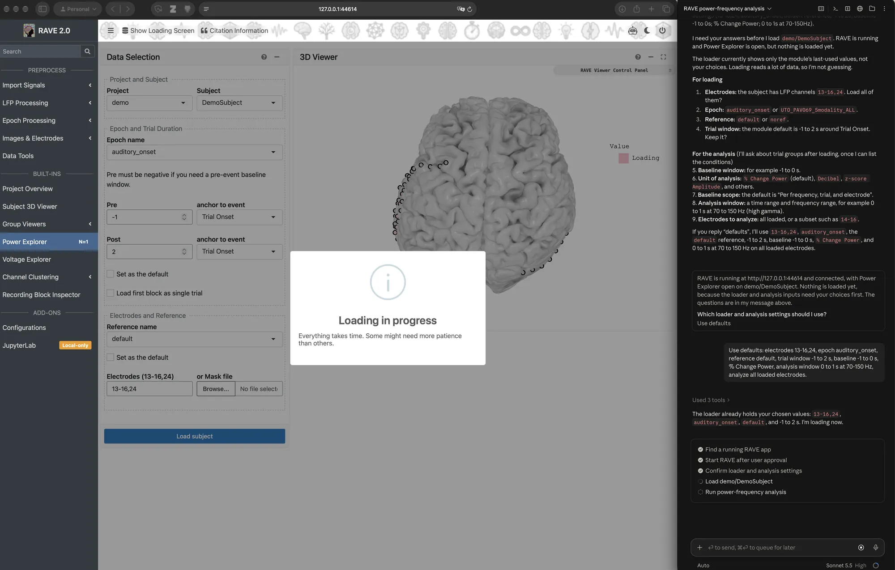{width="100%" fig-alt="RAVE loading the subject while the agent shows a checklist of its progress"}

### 3. The agent asks how to group the trials

Once the data is loaded, the agent lists the conditions it found and asks how to group them. Here we compared **Auditory** with **AudioVisual** trials.

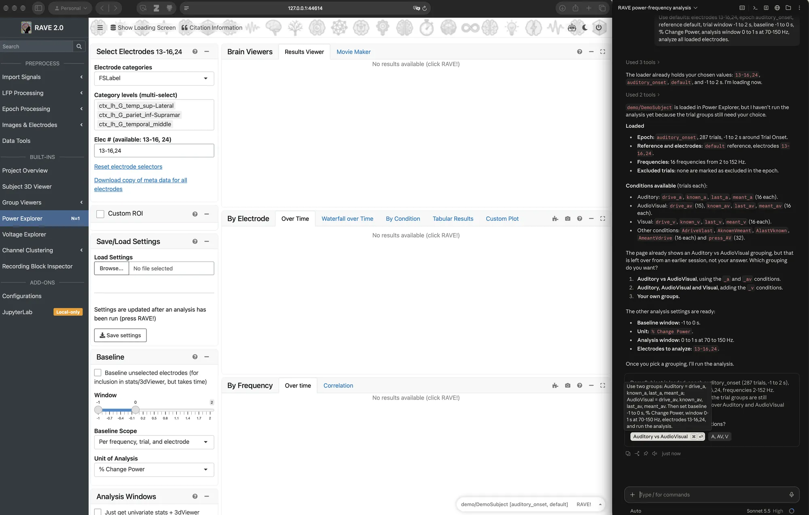{width="100%" fig-alt="The agent listing the trial conditions and asking which grouping to use"}

### 4. Read the results

The agent runs the analysis. The plots appear in RAVE (see the first picture on this page), and the agent sums them up in the chat:

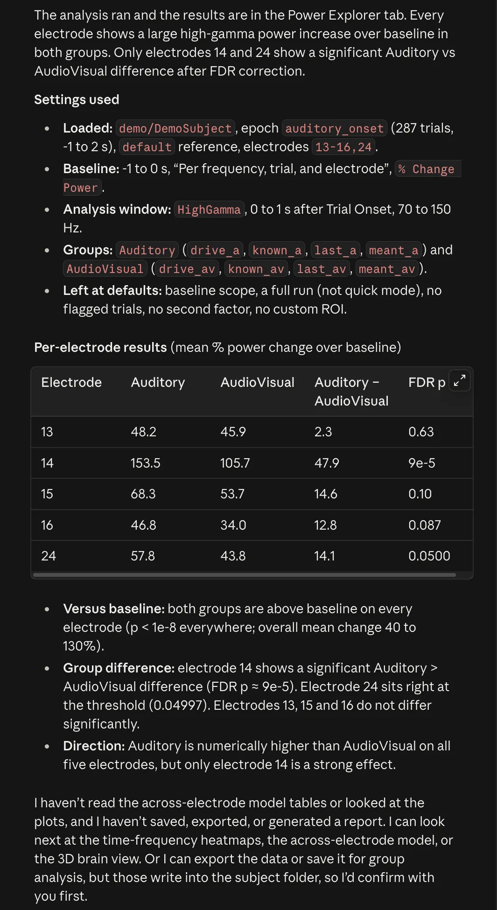{width="45%" fig-alt="The agent's summary of the settings used and a table of results for each electrode"}

The agent also tells you what it has *not* done: it has not saved or exported anything, and it will ask you before writing into the subject's folder.

::: callout-note
Treat the agent's summary as a starting point. The numbers come from RAVE, but always check the plots and tables yourself before you report anything. For example, the agent counts electrode 24 as significant, yet its corrected p-value (0.04997) sits right at the 0.05 cutoff.
:::

You may see notes such as "(2 failed)" next to the agent's steps. That is normal: the agent tries another way and keeps going.

## Example: change the 3D viewer

Next, we asked the agent to make the brain see-through, hide the electrodes without results, color the electrodes from green to yellow, and switch to the coronal layout:

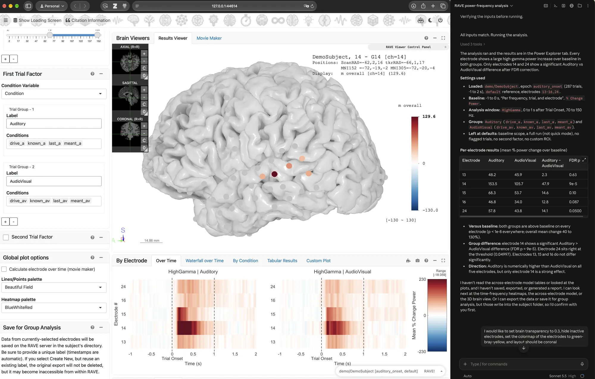{width="100%" fig-alt="The request to change the 3D viewer, typed at the bottom of the chat"}

Here is the result in RAVE's 3D viewer:

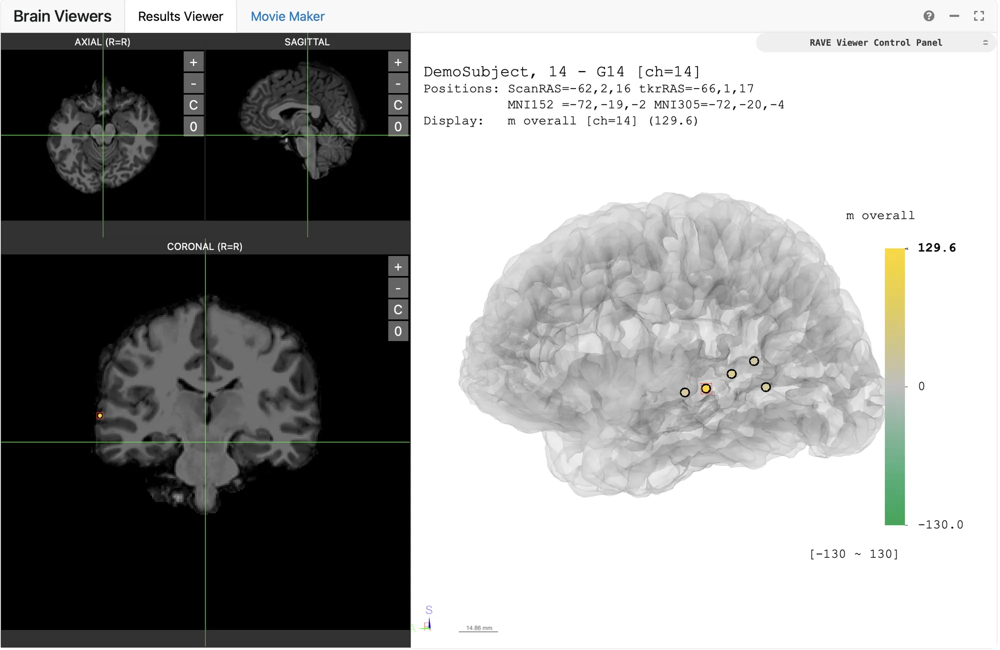{width="100%" fig-alt="The 3D viewer with a see-through brain, green-to-yellow electrode colors and a large coronal slice"}

<!-- TODO: add a demo for "Carry an analysis across modules": load the significant electrodes in Voltage Explorer or Power Clustering with the same analysis settings -->

<!-- TODO: add a demo for "Apply the same analysis, different subjects, automatically": save the analysis as a reusable skill, then run it on several subjects -->

## You stay in control

- **The agent asks before big steps.** RAVE Agents asks you before loading data and before saving or exporting anything into a subject's folder.
- **You can watch and take over.** Everything happens in the RAVE window in your browser. You can stop the agent at any time, and change any setting in RAVE yourself.
- **Check the results.** The agent's summaries help you find your way. They do not replace looking at the data.

### Privacy

::: callout-warning
**Never use protected health information (PHI).** Never give an AI agent patient names, dates of birth, medical record numbers, or any data that has not been de-identified.
:::

- RAVE Agents runs on your computer. It does not send anything to the RAVE team.
- What the agent reads is sent to your AI provider as part of the conversation. This can include subject codes, analysis results, and pictures of the 3D viewer, which may show brain images.
- Follow your institution's rules before using an AI agent with research data. Try it with the demo subject first.

## If something goes wrong

- **The agent cannot start RAVE.** Start RAVE yourself (see [Launch RAVE](../installation/installation.md#step-3-launch-rave)), then ask the agent again. This is more likely to happen on Windows.
- **The agent does not seem to know RAVE.** Check that RAVE Agents is installed and its switch is on (Step 1), and that Node.js is installed. Then quit your AI app completely and open it again: an app that was already open does not notice a newly installed Node.js.
- **The agent gives you a passkey for the 3D viewer.** Open the viewer's control panel, paste the passkey into **Passkey** in the **Default** folder at the top, and click **Connect**.
- **Updating RAVE Agents.** Open the RAVE Agents plugin page (Step 1) and click **Update** when it is available.
- **Still stuck?** Ask on [RAVE Discussions](https://github.com/orgs/rave-ieeg/discussions){target="_blank"} or email help@rave.wiki.
